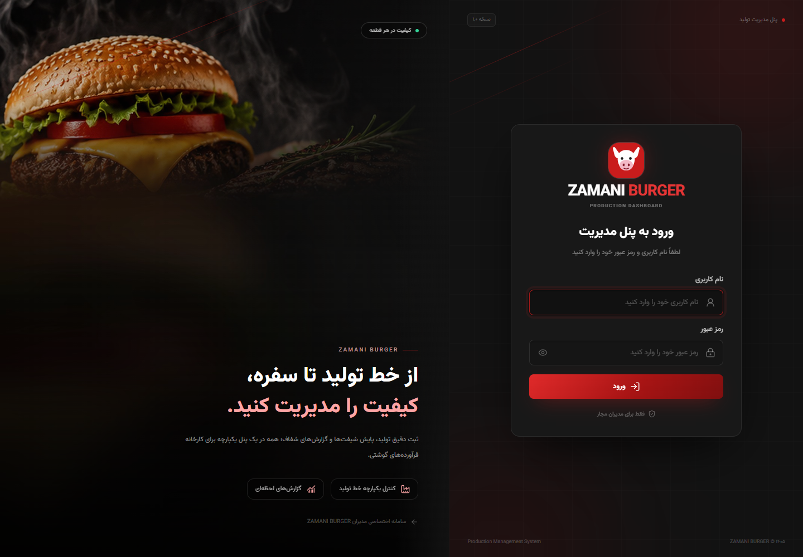
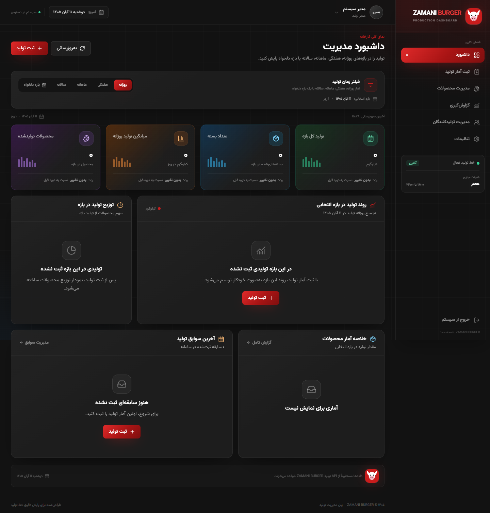

# ZAMANI BURGER — پنل مدیریت تولید

وب‌اپلیکیشن مدیریت تولید کارخانه، شامل احراز هویت JWT، ثبت آمار تولید، داشبورد تحلیلی با فیلتر زمانی، گزارش‌گیری، مدیریت محصولات و مدیریت کاربران. تمام داده‌های داشبورد از API واقعی Django خوانده می‌شوند و هیچ دادهٔ Mock یا سابقهٔ نمایشی در فرانت‌اند وجود ندارد.





## وضعیت فعلی داده‌ها

- **کاتالوگ محصول:** ۸ محصول نهایی با ارقام فارسی:

  | محصول |
  |---|
  | استیک ۶۰ درصد |
  | همبرگر ۶۰ درصد ۱۰۰ گرمی |
  | همبرگر ۹۰ درصد ۱۰۰ گرمی |
  | همبرگر ۶۰ درصد ۱۲۵ گرمی |
  | همبرگر ۹۰ درصد ۱۲۰ گرمی |
  | همبرگر ۹۰ درصد ۱۲۵ گرمی |
  | همبرگر ۹۰ درصد ۱۵۰ گرمی |
  | همبرگر ۹۰ درصد ۱۸۰ گرمی |

  «رست بیف» از کاتالوگ حذف شده و «استیک ۶۰ درصد» به محصولات مدیر ۶۰ درصد اضافه شده است.
- **تولیدکنندگان:** «مهدی زمانی» (مدیر ۶۰ درصد)، «خانم زارع» (مدیر ۹۰ درصد) و «علی توانا» (مدیر مواد اولیه). تولیدکنندهٔ «کمال اکبری» حذف شده است.
- **شیفت کاری (صبح/عصر/شب) به‌طور کامل حذف شده است** — از مدل دیتابیس، سریالایزر، فیلترها، فرم، جدول‌ها، داشبورد، گزارش‌ها، خروجی اکسل، ادمین و سایدبار.
- **دستور seed_demo حذف شده است** تا هیچ دادهٔ نمایشی به‌صورت خودکار ساخته نشود. ثبت آمار کاملاً دستی و از طریق فرم «ثبت آمار تولید» انجام می‌شود.
- حساب مدیر و کاتالوگ ۸ محصول آماده است؛ سوابق تولید، گاری و مواد اولیه باید توسط شما وارد شوند.

## امکانات

- **داشبورد مدیریت با فیلتر زمان و محصول:** نمای روزانه، هفتگی، ماهانه، سالانه و بازه دلخواه با تاریخ شمسی، به‌همراه فیلتر محصولات ۶۰ درصد / ۹۰ درصد / همه محصولات.
- چهار شاخص دوره‌ای: تولید کل، تعداد بسته، میانگین تولید روزانه و تعداد محصولات؛ همراه با مقایسه با دورهٔ قبل.
- نمودار روند تولید با تجمیع خودکار روزانه/هفتگی/ماهانه بر اساس طول بازه.
- نمودار توزیع محصولات و خلاصهٔ تولید محصولات در همان بازه.
- **ثبت آمار تولید** با تاریخ شمسی، محصول، مقدار کیلوگرم و تعداد بسته.
- **سه حالت ثبت برحسب نقش تولیدکننده:**
  - **مدیر ۶۰ درصد (مهدی زمانی):** وزن گوشت تحویلی، وزن گوشت تولیدی، تعداد بسته، وزن معدومی‌ها، وزن ضایعات و یادداشت.
  - **مدیر ۹۰ درصد (خانم زارع):** انتخاب تعداد بسته + محصول ۹۰ درصد (۱۰۰/۱۲۰/۱۲۵/۱۵۰/۱۸۰ گرمی) و افزودن آن با تیک به لیست روز؛ پس از افزودن همهٔ محصولات، وزن معدومی‌ها، وزن ضایعات و یادداشت وارد و همهٔ ردیف‌ها یک‌جا برای همان روز ثبت می‌شوند.
  - **مواد اولیه (علی توانا):** انتخاب گاری ۱ تا ۵ و ثبت فوری وزن گوشت ورودی و خروجی هر گاری، سپس ورودی/مصرفی پیاز و مرغ و یادداشت.
- صفحهٔ «ثبت آمار تولید» دارای دو تب «سوابق تولید» (گروه‌بندی‌شده بر اساس روز کاری) و «مواد اولیه و گاری» (اطلاعات هر روز کاری یکجا) است.
- هر دو تب یک نوار **بازه زمانی** با گزینه‌های همه/روزانه/هفتگی/ماهانه/سالانه/بازه دلخواه دارند.
- جدول سوابق با صفحه‌بندی، جستجو، مشاهده جزئیات (شامل یادداشت و ضایعات) و حذف با تأیید.
- **گزارش‌گیری** با بازه تاریخ شمسی، تفکیک محصول، شاخص‌های دوره، خروجی CSV و **دانلود اکسل مخصوص مدیر**.
- خروجی اکسل شامل سه شیت «خلاصه»، «عملکرد محصولات» و «ریز تولید» با تاریخ شمسی، نمودار محصولات و قالب راست‌به‌چپ است.
- مدیریت محصولات شامل افزودن، ویرایش، فعال/غیرفعال‌سازی و بارگذاری تصویر.
- مدیریت تولیدکنندگان برای مدیران؛ ایجاد کاربر، ویرایش اطلاعات و کنترل دسترسی.
- تنظیمات پروفایل و تغییر رمز عبور.
- رابط کاربری RTL با فونت Vazirmatn، تم تیره و رنگ برند قرمز.
- Refresh خودکار JWT بدون خروج کاربر.
- طراحی ریسپانسیو برای دسکتاپ و موبایل.

## پیش‌نیازها

- Python 3.10 یا بالاتر
- Node.js 20 یا بالاتر و npm
- Windows 10/11 (دستورها برای CMD نوشته شده‌اند)

## راه‌اندازی — Windows CMD

### ۱. بک‌اند

```cmd
cd dash\backend
py -m venv venv
venv\Scripts\activate
pip install -r requirements.txt
copy .env.example .env
python manage.py migrate
python manage.py runserver 127.0.0.1:8000
```

> اگر پورت 8000 توسط پروژهٔ دیگری اشغال شد، بک‌اند را روی پورت دیگری بالا بیاورید و در `frontend/.env.local` مقدار `VITE_PROXY_TARGET` را همان پورت بگذارید (بخش «تنظیمات محیطی»).

- فایل `.env` موجود از قبل آماده است. برای نصب تازه، مقادیر `SECRET_KEY` را تغییر دهید.
- برای ساخت مدیر جدید در نصب تازه: `python manage.py createsuperuser`
- پنل ادمین Django: `http://127.0.0.1:8000/admin/`

### ۲. فرانت‌اند

در یک پنجرهٔ CMD جدید:

```cmd
cd dash\frontend
npm install
npm run dev
```

سپس باز کنید: **http://127.0.0.1:5173**

### ۳. ورود پیش‌فرض

| نام کاربری | رمز عبور |
|---|---|
| `admin` | رمزی که هنگام ساخت کاربر تعیین کرده‌اید |

> در محیط توسعه، کاربر مدیر را با `python manage.py createsuperuser` بسازید. رمز عبور را از صفحهٔ «تنظیمات» هم می‌توانید تغییر دهید. برای محیط واقعی حتماً رمز قوی جدید تعیین کنید.

## اجرای سریع با اسکریپت

```powershell
powershell -ExecutionPolicy Bypass -File .\dash\scripts\start-dev.ps1
```

اسکریپت در صورت نبود `.env` آن را از `.env.example` می‌سازد و بک‌اند و فرانت‌اند را در دو پنجرهٔ PowerShell اجرا می‌کند.

## فیلترهای زمانی و محصول داشبورد

| گزینه | بازه |
|---|---|
| روزانه | امروز |
| هفتگی | از شنبهٔ هفتهٔ جاری تا امروز |
| ماهانه | از اول ماه شمسی جاری تا امروز |
| سالانه | از اول فروردین سال شمسی جاری تا امروز |
| بازه دلخواه | هر بازه حداکثر یک‌ساله با تاریخ شمسی |

- در کنار فیلتر زمان، فیلتر محصول با گزینه‌های «همه محصولات»، «۶۰ درصد» و «۹۰ درصد» قرار دارد و تمام کارت‌ها و نمودارهای داشبورد را فیلتر می‌کند.
- نمودار برای بازه‌های تا ۳۱ روز، روزانه؛ تا ۱۲۰ روز، هفتگی؛ و برای بازه‌های بلندتر، ماهانه تجمیع می‌شود.
- مقایسهٔ شاخص‌ها با **دورهٔ قبل هم‌طول** انجام می‌شود.
- میانگین روزانه بر تعداد روزهای تقویمی بازه (شامل روزهای بدون ثبت) محاسبه می‌شود.
- شاخص‌های «زمان تولید» و «تحقق برنامه» به‌طور کامل حذف شده‌اند.

## ساختار پروژه

```text
dash/
├── README.md
├── DEPLOY.md                     # راهنمای انتشار
├── render.yaml                   # Blueprint بک‌اند روی Render
├── backend/
│   ├── manage.py
│   ├── requirements.txt
│   ├── .env.example
│   ├── zamaniburger_backend/
│   │   ├── settings.py
│   │   └── urls.py
│   └── production/
│       ├── models.py             # Product, ProductionRecord
│       ├── serializers.py
│       ├── views.py
│       ├── services.py           # آمار دوره‌ای، نمودار و گزارش
│       ├── exports.py            # تولید فایل Excel گزارش
│       ├── urls.py
│       ├── admin.py
│       ├── tests.py
│       ├── management/commands/seed_catalog.py
│       └── migrations/
├── frontend/
│   ├── index.html
│   ├── vercel.json               # تنظیمات SPA روی Vercel
│   ├── vite.config.js
│   ├── tailwind.config.js
│   ├── public/
│   │   ├── fonts/                # Vazirmatn
│   │   └── images/login-hero.jpg
│   └── src/
│       ├── api/client.js
│       ├── components/           # PeriodFilter، StatCard، ...
│       ├── context/
│       ├── pages/                # Dashboard، Production، Reports، ...
│       ├── utils/                # تاریخ جلالی، بازه‌ها، قالب‌بندی
│       ├── App.jsx
│       └── index.css
├── docs/
│   └── screenshots/              # دو تصویر معرفی
├── scripts/start-dev.ps1
└── tools/qa-ui.mjs               # آزمون End-to-End
```

## مدل داده

### Product

| فیلد | نوع | توضیح |
|---|---|---|
| `name` | CharField (unique) | نام محصول |
| `image` | ImageField (optional) | تصویر محصول |
| `is_active` | Boolean | نمایش در فرم ثبت تولید |
| `created_at` | DateTime | تاریخ ایجاد |

### ProductionRecord

| فیلد | نوع | توضیح |
|---|---|---|
| `date` | DateField | تاریخ تولید |
| `product` | FK → Product (PROTECT) | محصول |
| `amount_kg` | Decimal(12,2) | مقدار تولید، بزرگ‌تر از صفر |
| `packages_count` | PositiveInteger | تعداد بسته |
| `created_by` | FK → User (PROTECT) | ثبت‌کننده (از توکن) |
| `created_at` | DateTime | زمان ثبت |

> فیلد `shift` (شیفت) حذف شده است.

### GarriRecord (سوابق گاری)

برای تولیدکنندهٔ نقش «مدیر مواد اولیه» (هر گاری در هر روز یک ردیف یکتا):

| فیلد | نوع | توضیح |
|---|---|---|
| `date` | DateField | تاریخ ثبت |
| `producer` | FK → Producer (PROTECT) | تولیدکننده |
| `garri` | CharField (choices ۱ تا ۵) | شمارهٔ گاری |
| `meat_input_kg` | Decimal(12,2) | وزن گوشت ورودی گاری (کیلوگرم) |
| `meat_output_kg` | Decimal(12,2) | وزن گوشت خروجی گاری (کیلوگرم) |
| `note` | TextField | یادداشت (اختیاری) |
| `created_by` | FK → User (PROTECT) | ثبت‌کننده |
| `created_at` | DateTime | زمان ثبت |

> قید یکتایی `(date, producer, garri)` باعث می‌شود ثبت دوبارهٔ همان گاری در همان روز، وزن را به‌روزرسانی کند.

### MaterialRecord (مواد اولیه)

برای تولیدکنندهٔ نقش «مدیر مواد اولیه»:

| فیلد | نوع | توضیح |
|---|---|---|
| `date` | DateField | تاریخ ثبت |
| `producer` | FK → Producer (PROTECT) | تولیدکننده |
| `onion_input_kg` | Decimal(12,2) | ورودی پیاز (کیلوگرم) |
| `chicken_input_kg` | Decimal(12,2) | ورودی مرغ (کیلوگرم) |
| `onion_used_kg` | Decimal(12,2) | پیاز مصرفی (کیلوگرم) |
| `chicken_used_kg` | Decimal(12,2) | مرغ مصرفی (کیلوگرم) |
| `note` | TextField | یادداشت (اختیاری) |
| `created_by` | FK → User (PROTECT) | ثبت‌کننده |
| `created_at` | DateTime | زمان ثبت |

## API

همهٔ مسیرها به‌جز دریافت توکن، نیازمند هدر زیر هستند:

```http
Authorization: Bearer <access_token>
```

| متد | مسیر | دسترسی | توضیح |
|---|---|---|---|
| POST | `/api/token/` | عمومی | دریافت Access/Refresh + اطلاعات کاربر |
| POST | `/api/token/refresh/` | عمومی | تازه‌سازی Access Token |
| GET/PATCH | `/api/me/` | کاربر واردشده | مشاهده/ویرایش پروفایل |
| POST | `/api/me/password/` | کاربر واردشده | تغییر رمز عبور |
| GET/POST | `/api/products/` | خواندن: همه، ایجاد: مدیر | فهرست/ایجاد محصول |
| PATCH/DELETE | `/api/products/<id>/` | مدیر | ویرایش/حذف محصول |
| GET/POST | `/api/records/` | کاربر واردشده | فهرست/ایجاد سابقه تولید |
| GET/DELETE | `/api/records/<id>/` | حذف: سازنده یا مدیر | جزئیات/حذف سابقه |
| POST | `/api/records/bulk/` | کاربر واردشده | ثبت گروهی چند محصول برای یک روز (فقط مدیر ۹۰ درصد) |
| GET/POST | `/api/garri/` | کاربر واردشده | فهرست/ایجاد (upsert) وزن گاری |
| GET/DELETE | `/api/garri/<id>/` | حذف: سازنده یا مدیر | جزئیات/حذف وزن گاری |
| GET/POST | `/api/materials/` | کاربر واردشده | فهرست/ایجاد سابقه مواد اولیه |
| GET/DELETE | `/api/materials/<id>/` | حذف: سازنده یا مدیر | جزئیات/حذف سابقه مواد اولیه |
| GET | `/api/workdays/` | کاربر واردشده | اطلاعات یکجای هر روز کاری (گاری‌ها + مواد اولیه) |
| GET | `/api/health/` | عمومی | بررسی سلامت سرویس و اتصال دیتابیس |
| GET | `/api/stats/?start=YYYY-MM-DD&end=YYYY-MM-DD` | کاربر واردشده | آمار دوره‌ای |
| GET | `/api/chart/production/?start=...&end=...` | کاربر واردشده | نمودار روند دوره |
| GET | `/api/chart/distribution/?start=...&end=...` | کاربر واردشده | توزیع محصولات در دوره |
| GET | `/api/reports/summary/?start=...&end=...` | کاربر واردشده | خلاصه گزارش |
| GET | `/api/reports/export/?start=...&end=...` | فقط مدیر | دانلود گزارش Excel در بازه انتخابی |
| GET/POST | `/api/users/` | فقط مدیر | فهرست/ایجاد کاربران |
| PATCH | `/api/users/<id>/` | فقط مدیر | ویرایش/فعال‌سازی کاربر |

### پارامترهای مفید

- `stats` و `chart` و `distribution`: `start`, `end` (میلادی ISO؛ رابط کاربری خودش تاریخ شمسی را تبدیل می‌کند) و `product_type` (`60` یا `90`).
- `records`: `page`, `page_size`, `product`, `product_type`, `start_date`, `end_date`, `search`
- `garri` و `materials`: `page`, `page_size`, `producer`, `start_date`, `end_date`, `search`
- `workdays`: `page`, `page_size`, `producer`, `date`, `start_date`, `end_date`, `garri`
- `products`: `active=1` یا `active=0`, `search`
- پاسخ‌های صفحه‌بندی‌شده شامل `count`, `next`, `previous`, `results` هستند.
- محدودیت ورود: ۱۰ درخواست در دقیقه برای هر IP.

### نمونهٔ پاسخ `/api/stats/`

```json
{
  "period": { "start": "2026-11-01", "end": "2026-11-02", "days": 2 },
  "previous_period": { "start": "2026-10-30", "end": "2026-10-31" },
  "totals": {
    "amount_kg": 2250.5,
    "packages_count": 1000,
    "products_count": 1,
    "records_count": 2,
    "daily_average_kg": 1125.25
  },
  "changes": {
    "amount_kg": 350.1,
    "packages_count": 350.1,
    "products_count": 100.0,
    "records_count": 100.0,
    "daily_average_kg": 350.1
  }
}
```

## طراحی

| نقش | رنگ |
|---|---|
| پس‌زمینه اصلی | `#121212` |
| پنل | `#1e1e1e` |
| قرمز برند | `#c91c1c` |
| سبز | `#2e7d32` |
| آبی | `#1976d2` |
| نارنجی | `#ed6c02` |
| بنفش | `#7b1fa2` |
| متن ثانویه | `#a0a0a0` |

- فونت: Vazirmatn با فایل‌های WOFF2 محلی.
- جهت: `dir="rtl"` و `lang="fa"`.
- استایل‌ها با TailwindCSS؛ نمودارها با Recharts؛ آیکون‌ها با React Icons.
- برند: **ZAMANI BURGER** (لوگو، عنوان صفحات، پنل ادمین و خروجی‌ها).

## آزمون‌ها

### بک‌اند

```cmd
cd dash\backend
python manage.py test
```

نتیجه: **۶۲ تست موفق** شامل احراز هویت، Refresh Token، دسترسی‌ها، اعتبارسنجی، CRUD محصولات، ثبت/حذف سابقه تولید، ثبت گروهی چندمحصولی (bulk)، سوابق گاری و مواد اولیه، وزن خروجی گاری، گروه‌بندی روز کاری (`workdays`)، فیلتر ۶۰/۹۰ درصد، آمار بازه‌های زمانی مختلف، نمودارها، توزیع، گزارش، خروجی اکسل و مدیریت کاربران.

آزمون E2E نهایی: **۳۳ بررسی موفق**؛ تمام داده‌های موقت آزمون در پایان پاک می‌شوند.

### خروجی Excel

- دکمهٔ **«دانلود اکسل»** فقط برای کاربران `is_staff` در هدر صفحهٔ گزارش‌گیری نمایش داده می‌شود.
- API با `IsAdminUser` محافظت می‌شود و برای کاربران عادی `403` برمی‌گرداند.
- فایل شامل شیت‌های خلاصه، عملکرد محصولات (همراه نمودار) و ریز سوابق است.
- تاریخ‌های داخل فایل شمسی هستند و فایل با `openpyxl` تولید و با `Content-Disposition` دانلود می‌شود.

### فرانت‌اند

```cmd
cd dash\frontend
npm run build
```

بیلد تولیدی در `frontend/dist` ساخته می‌شود و مسیرها به‌صورت Lazy Load تقسیم شده‌اند.

### آزمون End-to-End

پس از اجرای هر دو سرور و نصب `playwright-core`:

```cmd
cd dash\tools
npm install
node qa-ui.mjs
```

اسکریپت با Chrome نصب‌شده اجرا می‌شود (مسیر Chrome در ابتدای فایل قابل تنظیم است) و فیلترهای زمانی، ثبت/حذف سابقه، گزارش CSV، دانلود اکسل، محصولات، دسترسی مدیر، تنظیمات، Refresh Token و ریسپانسیو را بررسی می‌کند. داده‌های موقت آزمون در پایان پاک می‌شوند.

## تصاویر

| صفحه | تصویر |
|---|---|
| ورود (دسکتاپ) | [مشاهده](docs/screenshots/01-login-desktop.png) |
| داشبورد (دسکتاپ) | [مشاهده](docs/screenshots/02-dashboard-desktop.png) |

## تنظیمات محیطی

### `backend/.env`

```env
DEBUG=True
SECRET_KEY=یک-کلید-تصادفی-طولانی
ALLOWED_HOSTS=127.0.0.1,localhost
# برای اجرای محلی خالی بماند (SQLite)؛ در سرور رشته Postgres
DATABASE_URL=
CORS_ALLOWED_ORIGINS=http://127.0.0.1:5173,http://localhost:5173
CSRF_TRUSTED_ORIGINS=
```

### `frontend/.env.local` (اختیاری)

در توسعه، Vite مسیر `/api` و `/media` را به `VITE_PROXY_TARGET` پروکسی می‌کند (پیش‌فرض `http://127.0.0.1:8000`). اگر پورت 8000 توسط پروژهٔ دیگری اشغال شد:

```env
# بک‌اند را روی پورت دیگری بالا بیاورید:
#   python manage.py runserver 127.0.0.1:8001
VITE_PROXY_TARGET=http://127.0.0.1:8001
```

برای دامنه‌های جدا:

```env
VITE_API_URL=https://api.example.com/api
```

## استقرار در محیط واقعی

معماری پیشنهادی و آماده‌شده در این مخزن:

| بخش | سرویس | تنظیمات |
|---|---|---|
| فرانت‌اند | **Vercel** | Root Directory = `frontend`، متغیر `VITE_API_URL` |
| بک‌اند | **Render** | Root Directory = `backend`، فایل `render.yaml` |
| دیتابیس | **Postgres (Neon)** | متغیر `DATABASE_URL` |

- راهنمای کامل قدم‌به‌قدم: [DEPLOY.md](DEPLOY.md)
- فایل‌های آماده: [`render.yaml`](render.yaml)، [`frontend/vercel.json`](frontend/vercel.json)، [`.github/workflows/ci.yml`](.github/workflows/ci.yml)
- بررسی سلامت سرویس: `GET /api/health/`
- ساخت داده اولیه روی سرور: `python manage.py seed_catalog`

اگر می‌خواهی همه‌چیز را روی یک سرور اختصاصی (VPS) اجرا کنی:

1. `DEBUG=False` و `SECRET_KEY` تصادفی قوی تنظیم شود.
2. `ALLOWED_HOSTS`، `CORS_ALLOWED_ORIGINS` و `CSRF_TRUSTED_ORIGINS` محدود شوند.
3. `python manage.py migrate` و `python manage.py collectstatic` اجرا شوند.
4. `frontend/dist` با Nginx/IIS سرو و برای SPA fallback به `index.html` تنظیم شود.
5. پوشهٔ `media` در وب‌سرور یا Object Storage سرو شود.
6. HTTPS اجباری شود؛ JWT در `localStorage` ذخیره می‌شود، بنابراین CSP و پاک‌سازی ورودی‌ها ضروری است.
7. رمز پیش‌فرض مدیر تغییر کند و `/admin/` محدود شود.
8. برای حجم بالا از Postgres استفاده شود (SQLite فقط برای توسعه است).

## محدودیت‌ها

- **JWT در localStorage:** مطابق سند اولیه پیاده‌سازی شده است؛ برای امنیت بالاتر می‌توان به کوکی HttpOnly منتقل کرد.
- **بدون WebSocket:** به‌روزرسانی داده‌ها با دکمهٔ به‌روزرسانی یا تغییر فیلتر انجام می‌شود.
- **بازه حداکثر یک سال:** برای حفظ کارایی و خوانایی نمودارها اعمال شده است.
- **تصویر محصول اختیاری است**؛ در نبود تصویر، آیکون جایگزین نمایش داده می‌شود.
